# Invoice Management System (IMS)

> **Full-Stack Financial Operations Platform & Client Self-Service Portal**  
> Built with Angular 17, TypeScript, Tailwind CSS, Chart.js, Java 21, Spring Boot 3.2, Spring Security, PostgreSQL, and OpenPDF — with an optional zero-backend IndexedDB Portfolio Demo mode.


> **Interactive Portfolio Demo:** *(Vercel production URL will be linked here after deployment)*  
> **Source Repository:** [https://github.com/aymenALa/Invoice-Management-System](https://github.com/aymenALa/Invoice-Management-System)

---

## Navigation

- [Project Background & Authorship](#project-background--authorship)
- [Product Capabilities](#product-capabilities)
- [Technology Stack](#technology-stack)
- [System Architecture](#system-architecture)
- [Security Architecture](#security-architecture)
- [Database Design](#database-design)
- [Financial Integrity](#financial-integrity)
- [Interactive Portfolio Demo](#interactive-portfolio-demo)
- [API Documentation](#api-documentation)
- [Installation & Configuration](#installation--configuration)
- [Testing & Verification](#testing--verification)
- [Screenshots](#screenshots)
- [Licensing & Attribution](#licensing--attribution)

---

## Project Background & Authorship

The **Invoice Management System (IMS)** was independently designed and engineered from scratch by **Aymen Alioua** as a full-stack financial operations platform and client self-service portal.

To clearly distinguish original engineering from subsequent enhancements:

1. **Original Full-Stack Implementation (`main`):**
   - Designed the relational PostgreSQL domain model (`users`, `clients`, `invoices`, `client_invitations`, `client_portal_accounts`, `user_roles`).
   - Implemented Spring Security stateless JWT authentication with separate `USER` (business) and `CLIENT` (portal) token claims, BCrypt password hashing, `SecureRandom` 8-character invitation codes with 7-day expiration, single-use activation, code regeneration/invalidation, immediate blocked-account enforcement, password recovery via SMTP, and PDF generation.
   - Built the Angular 17 standalone SPA with route guards, auth interceptor, Chart.js visualizations, and client portal UI.

2. **Technical Audit, Hardening & UI Modernization:**
   - Redesigned the UI into a cohesive midnight-navy financial SaaS experience (`#0B0F19` canvas, `#131C2B` surface, `#6366F1` indigo accent, semantic status tokens) with responsive navigation (`320px`–`1440px+`).
   - Aligned `InvoiceService.updateInvoice` validation with `createInvoice`, fixed `DashboardService` aggregations to separate `paidAmount`, `invoicedAmount`, `outstandingAmount`, `overdueAmount`, `draftAmount`, and `cancelledAmount`, added client deletion protection when invoices exist, hardened JWT filter exception handling, added a fail-fast `prod` Spring profile, and migrated backend PDF generation from AGPLv3 iText 7 to MIT-compatible OpenPDF 1.3.39.

3. **Browser-Local Interactive Portfolio Demo:**
   - Added an environment-controlled Angular `demo` build (`environment.demo.ts` + `demoInterceptor` + IndexedDB `DemoBackendService` + `DemoInboxComponent` + lazy-loaded `jsPDF`) so recruiters can explore both roles without registration, backend servers, or cloud databases.

---

## Product Capabilities

- **Financial Dashboard:** Real-time KPIs (`Paid Revenue`, `Total Invoiced`, `Outstanding`, `Overdue Exposure`), secondary pipeline counters (`Draft`, `Cancelled`, `Active Clients`), monthly Invoiced vs. Paid bar chart, and full-dataset Status Distribution doughnut chart.
- **Invoice Management:** Full CRUD across `DRAFT`, `SENT`, `PAID`, `OVERDUE`, and `CANCELLED` statuses with server-side search, status filtering, sorting, pagination, and print-ready PDF export.
- **Client Directory:** Searchable directory with portal status filters (`Active`, `Blocked`, `Not Activated`), per-client invoice history, full statement PDF export, and referential deletion protection.
- **Client Self-Service Portal:** Separate read-only portal where activated clients inspect their own invoices, download PDFs, and update safe contact fields (`name`, `phoneNumber`, `address`).
- **Invitation & Access Lifecycle:** Generate, copy, email, or regenerate 8-character invitation codes, and block/unblock client portal access at any time.
- **Account Management:** Business registration, login, password recovery, profile synchronization, and password changes.

---

## Technology Stack

| Layer | Technologies & Versions |
|---|---|
| **Frontend** | Angular `^17.2.0` (standalone components), TypeScript `~5.3.2`, Tailwind CSS `^3.4.6`, Chart.js `^4.4.3`, Font Awesome `^6.6.0`, SweetAlert2 `^11.12.3`, RxJS `~7.8.0` |
| **Backend** | Java `21`, Spring Boot `3.2.1`, Spring Security, Spring Data JPA, Spring Validation, Spring Mail (`JavaMailSender`), JJWT `0.11.5`, Lombok |
| **Database** | PostgreSQL `17` (Full-Stack Mode) / Browser IndexedDB `ims_portfolio_demo` (Portfolio Demo Mode) |
| **PDF Generation** | OpenPDF `1.3.39` (Backend Full-Stack) / `jsPDF` (Browser-Local Portfolio Demo) |
| **Testing** | JUnit 5 + Mockito, Jasmine + Karma (`ChromeHeadless`), Chrome DevTools Protocol (CDP) E2E scripts |

---

## System Architecture

### Dual-Mode Frontend & Full-Stack Backend

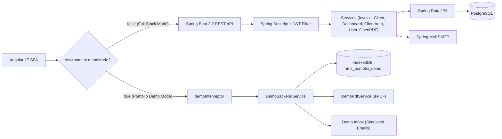

---

## Security Architecture

> **Important Distinction:** In **Full-Stack Mode**, all authentication, BCrypt hashing, JWT verification, ownership checks, and account blocking are enforced server-side by Spring Security and PostgreSQL. In **Portfolio Demo Mode**, business rules are simulated locally in the browser using IndexedDB and synthetic tokens (`demo-local-token`) so visitors can explore safely without a backend—browser-local checks are demonstrations of business rules, not server-side security boundaries.

### Original & Hardened Server-Side Controls

- **Spring Security Stateless Filter Chain:** Configured in `SecurityConfig` with `SessionCreationPolicy.STATELESS`, `BCryptPasswordEncoder`, and explicit public allowlists (`/api/auth/**`, `/api/client-auth/activate`, `/api/client-auth/login`).
- **Separate Business (`USER`) & Client (`CLIENT`) JWT Contexts:**
  - `JwtUtil.generateToken` issues `accountType = "USER"` tokens for business users.
  - `JwtUtil.generateClientToken` issues `accountType = "CLIENT"` tokens carrying `clientAccountId` and `clientId`.
  - `JwtAuthenticationFilter` explicitly skips `CLIENT` tokens so a client JWT can never authenticate against `/api/invoices`, `/api/clients`, `/api/dashboard`, or `/api/user-profile` (returning `401 Unauthorized`).
- **BCrypt Password & Invitation Code Hashing:** Both business user passwords, client portal passwords, and 8-character invitation codes are hashed with BCrypt.
- **`SecureRandom` Invitations, 7-Day Expiration & Single-Use Activation:**
  - `ClientAuthService` generates 8-character codes from `ABCDEFGHJKLMNPQRSTUVWXYZ23456789` via `SecureRandom` with `expiresAt = now + 7 days`.
  - `activateClient` validates email, expiration, and BCrypt `codeHash`, creates `ClientPortalAccount`, and stamps `usedAt` so the invitation cannot be reused.
  - `regenerateClientInvitation` stamps `usedAt` on all open invitations for that client before issuing a new code.
  - *Trade-off Note:* `ClientInvitation` stores both `codeHash` (BCrypt) and `invitationCode` (plain) so business owners can re-view and copy an active code from the UI if email delivery is unavailable.
- **Ownership Enforcement & Cross-Tenant Isolation:** Every client, invoice, and dashboard query filters by the authenticated `User` (business) or `Client` (portal).
- **Immediate Blocked-Account Enforcement:** `ClientAuthService.getAccountFromAuthorizationHeader` queries `ClientPortalAccount` on every `/api/client-portal/**` request and rejects `!account.isEnabled()` with `401`, revoking access immediately even for previously issued JWTs.
- **Restricted Client Profile Updates:** `ClientPortalUpdateRequest` exposes only `name`, `phoneNumber`, and `address`; clients cannot modify their `email`, `enabled` status, or invoices.
- **Password Recovery & Reset Token Reuse Prevention:** `UserService.requestPasswordReset` generates a 32-byte `SecureRandom` URL-safe token with a 30-minute TTL; `resetPassword` clears `passwordResetToken` and `passwordResetTokenExpiresAt` upon use.
- **Production Fail-Fast Configuration:** `application-prod.properties` removes all fallback defaults for `DB_URL`, `DB_USERNAME`, `DB_PASSWORD`, and `JWT_SECRET`, and `JwtUtil` validates secret strength on startup when the `prod` profile is active.

### Security Sequence Diagrams

#### 1. Business Authentication & Protected API Requests
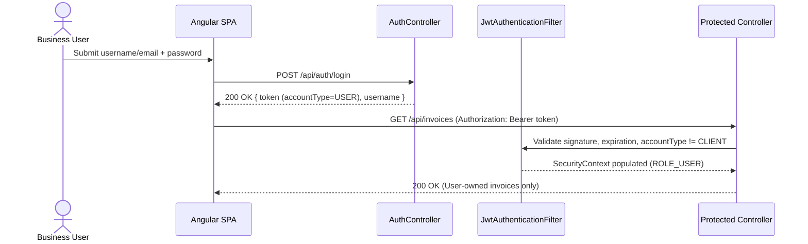

#### 2. Client Invitation & Activation Lifecycle
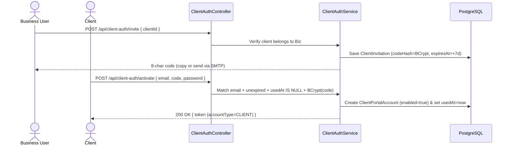

#### 3. Client Authentication & Invoice Authorization
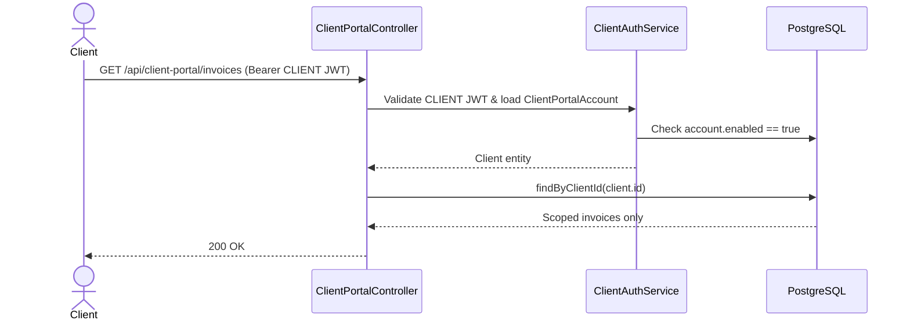

#### 4. Client Blocking & Immediate Session Rejection
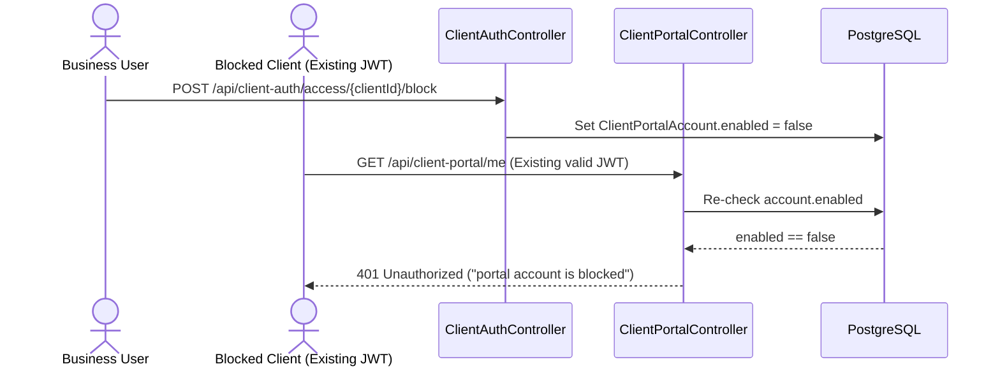

#### 5. Password Recovery Lifecycle
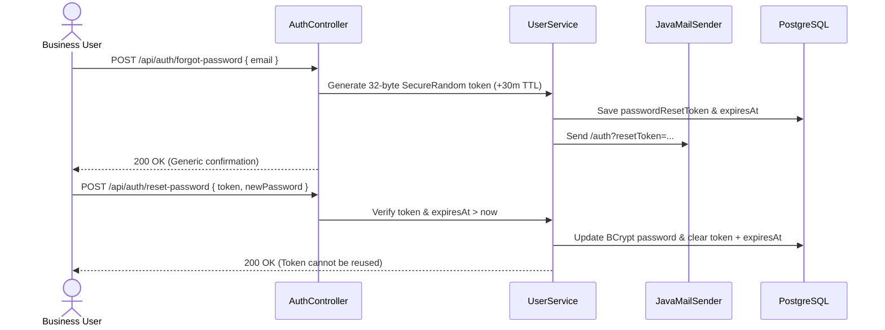

---

## Database Design

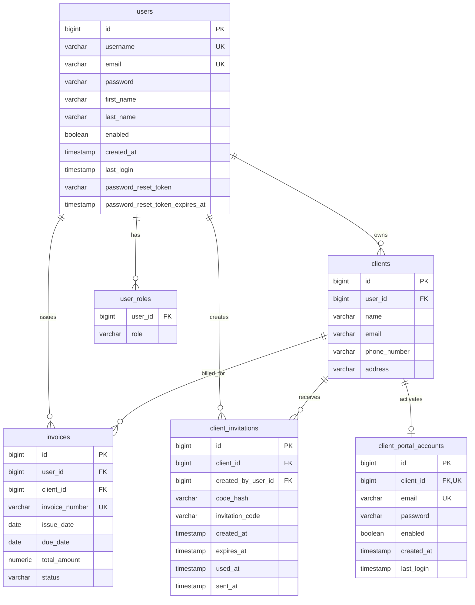

---

## Financial Integrity

- **Monetary Precision:** Backend entities use `BigDecimal` (`numeric(38,2)`) rounded with `RoundingMode.HALF_UP`; browser demo mode uses integer-cent (`Math.round(amount * 100)`) arithmetic.
- **Create & Update Validation Parity:** Both `createInvoice` and `updateInvoice` enforce non-blank unique `invoiceNumber`, `dueDate >= issueDate`, `totalAmount > 0`, and non-null `Client` belonging to the authenticated user.
- **Dashboard KPI Semantics:**
  - `paidAmount`: Sum of `PAID` invoices.
  - `invoicedAmount`: Sum of `PAID`, `SENT`, and `OVERDUE` invoices (excludes `DRAFT` and `CANCELLED`).
  - `outstandingAmount`: Sum of `SENT` and `OVERDUE` invoices.
  - `overdueAmount` & `overdueInvoices`: `OVERDUE` invoices plus `SENT` invoices past `dueDate` (never counts `CANCELLED`).
- **Client Deletion Protection:** Deleting a client with existing invoices is rejected (`400 BusinessException`) to preserve referential integrity; clients without invoices cleanly remove associated invitation/portal rows first.

---

## Interactive Portfolio Demo

When built with `--configuration demo`:
- **Zero Backend Required:** Runs completely in the browser with IndexedDB persistence (`ims_portfolio_demo`) and zero external API requests.
- **Passwordless `/demo` Entry & Role Switcher:** Switch between Business Workspace (`alex.mercer`, `sara.lin`) and eligible (activated, unblocked) Client Portal accounts.
- **Demo Inbox (`/demo/inbox`):** Captures simulated client invitation, regeneration, and password reset emails with code copying and 1-click activation/reset links.
- **Browser PDF Generation:** Generates downloadable single-invoice and statement PDFs locally using `jsPDF`.
- **Reset Demo Data:** Restores the 2-business, 18-client, 66-invoice synthetic dataset without clearing unrelated browser storage.

---

## API Documentation

| Access | Method & Endpoint | Description |
|---|---|---|
| Public | `POST /api/auth/register`, `/login`, `/forgot-password`, `/reset-password` | Business registration, JWT login, password recovery |
| Public | `POST /api/client-auth/activate`, `/login` | Client portal activation & JWT login |
| Business (`USER`) | `GET/PUT /api/user-profile`, `POST /api/user-profile/password` | Business profile & password management |
| Business (`USER`) | `GET /api/dashboard` | Financial KPIs, `statusCounts`, `monthlyTotals`, `recentInvoices` |
| Business (`USER`) | `GET/POST /api/clients`, `GET/PUT/DELETE /api/clients/{id}` | Client CRUD & deletion protection |
| Business (`USER`) | `GET/POST /api/invoices`, `GET/PUT/DELETE /api/invoices/{id}` | Paginated/filtered invoice CRUD |
| Business (`USER`) | `GET /api/invoices/{id}/pdf`, `/clients/{clientId}`, `/client/{clientId}/pdf` | Invoice PDF & per-client history/PDF |
| Business (`USER`) | `POST /api/client-auth/invite`, `/invite/regenerate`, `/invite/send` | Client invitation lifecycle |
| Business (`USER`) | `GET /api/client-auth/access/{id}`, `POST .../block`, `.../unblock` | Client portal access control |
| Client (`CLIENT`) | `GET/PUT /api/client-portal/me`, `GET /invoices`, `/invoices/{id}`, `.../pdf` | Scoped client profile, invoices & PDFs |

---

## Installation & Configuration

### Prerequisites
- Java 21, Maven (or included `./mvnw` / `mvnw.cmd`), PostgreSQL 15+, Node.js 20+ & npm.

### 1. Database Setup
```sql
CREATE DATABASE invoice_management_system;
```

### 2. Backend Configuration & Startup
Set environment variables (never commit real secrets):

**Windows (PowerShell):**
```powershell
cd backend
$env:DB_USERNAME="postgres"
$env:DB_PASSWORD="<your-postgres-password>"
$env:JWT_SECRET="<min-32-char-random-secret>"
$env:APP_FRONTEND_URL="http://localhost:4200"
.\mvnw.cmd spring-boot:run
```

**Linux / macOS:**
```bash
cd backend
export DB_USERNAME=postgres
export DB_PASSWORD="<your-postgres-password>"
export JWT_SECRET="<min-32-char-random-secret>"
export APP_FRONTEND_URL="http://localhost:4200"
./mvnw spring-boot:run
```

> **Production Profile:** Run with `-Dspring-boot.run.profiles=prod` (requires `DB_URL`, `DB_USERNAME`, `DB_PASSWORD`, and a strong `JWT_SECRET`; `ddl-auto=validate`).  
> **Optional SMTP:** Set `MAIL_HOST`, `MAIL_PORT`, `MAIL_USERNAME`, `MAIL_PASSWORD`, `MAIL_SMTP_AUTH`, and `MAIL_SMTP_STARTTLS`.

### 3. Frontend Startup & Builds
```bash
cd frontend
npm install

# Full-stack mode (http://localhost:4200 -> http://localhost:8080/api)
npm start

# Portfolio demo mode (http://localhost:4201, browser-local IndexedDB)
npm run start:demo

# Production builds
npm run build        # Full-stack output: dist/invoice-management-system-fe/browser
npm run build:demo   # Vercel static demo output: dist/invoice-management-system-fe/browser
```

---

## Testing & Verification

- **Backend (`mvn test`):** **17/17 passed** (`ClientServiceTest`, `InvoiceServiceTest`, `DashboardServiceTest`, `ClientAuthServiceTest`, `PdfGenerationServiceTest`).
- **Frontend (`ng test --watch=false --browsers=ChromeHeadless`):** **27/27 passed** (21 component/service/guard/interceptor specs + 6 `DemoBackendService` financial/lifecycle specs).
- **Real Browser E2E (Isolated Chrome CDP):** Verified both Full-Stack Mode (against isolated `invoice_management_system_test` PostgreSQL + local `127.0.0.1:1025` SMTP test sink) and Static Production Demo Build (zero external API requests, SPA route refresh, responsive layouts at `1440px`, `1024px`, `768px`, `390px`, `320px`, and downloadable PDF verification).
- **Known Limitations:** `InvoiceManagementSystemApplicationTests` (`@SpringBootTest`) remains commented out in the test suite; full-stack email delivery was verified against a local Python SMTP test sink rather than a live external Gmail SMTP relay.

---

## Screenshots

### Landing Page 2.0
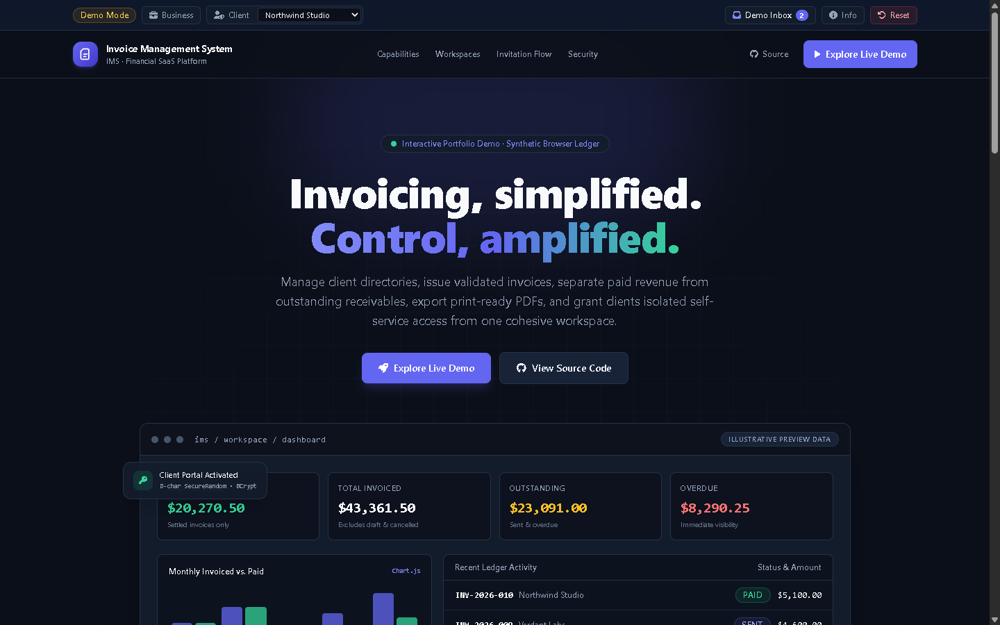

### Demo Role Selection (`/demo`)
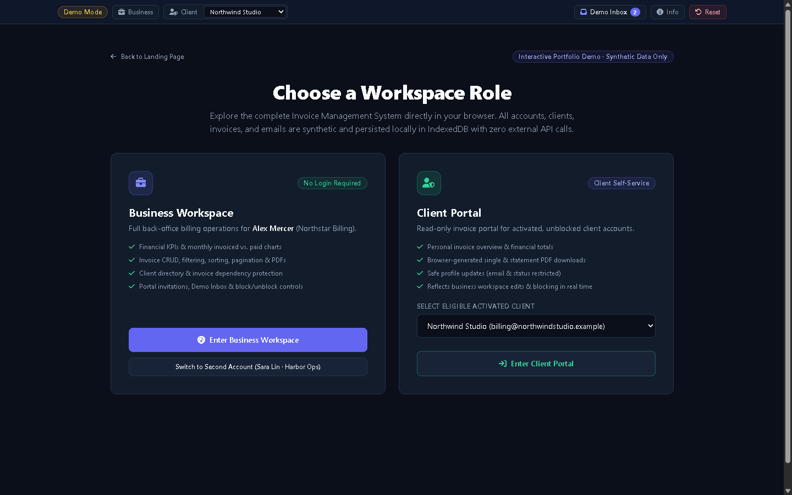

### Business Financial Dashboard
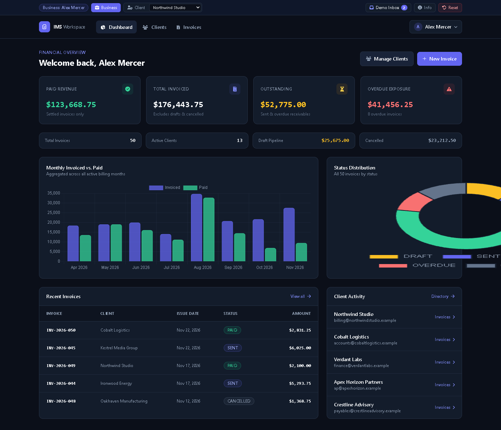

### Invoice Management
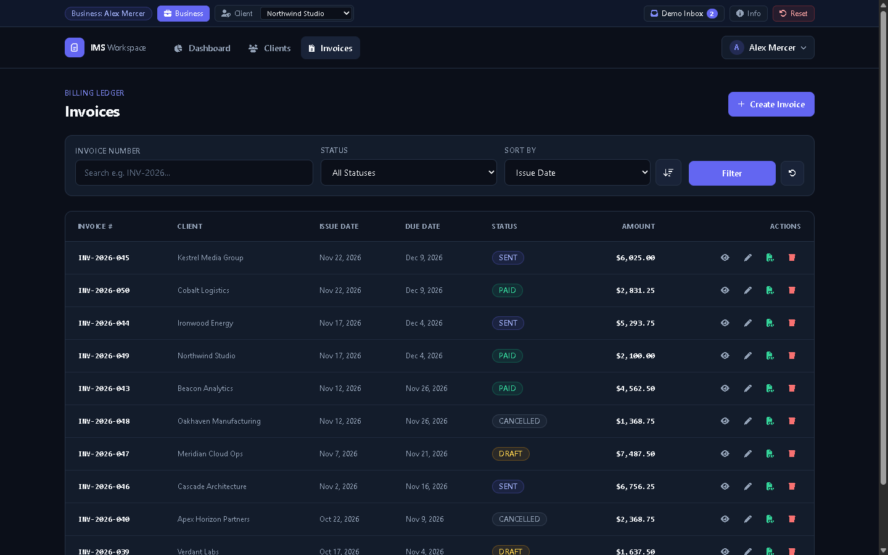

### Client Management & Portal Controls
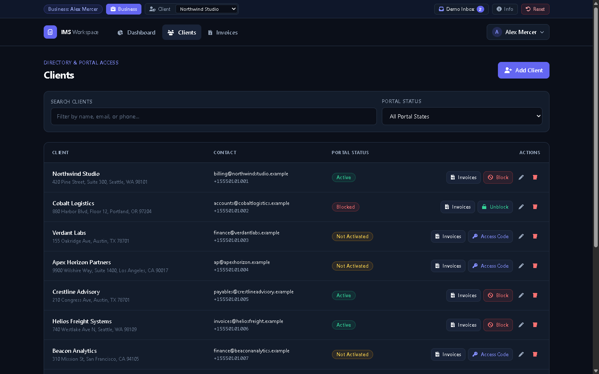

### Client Self-Service Portal
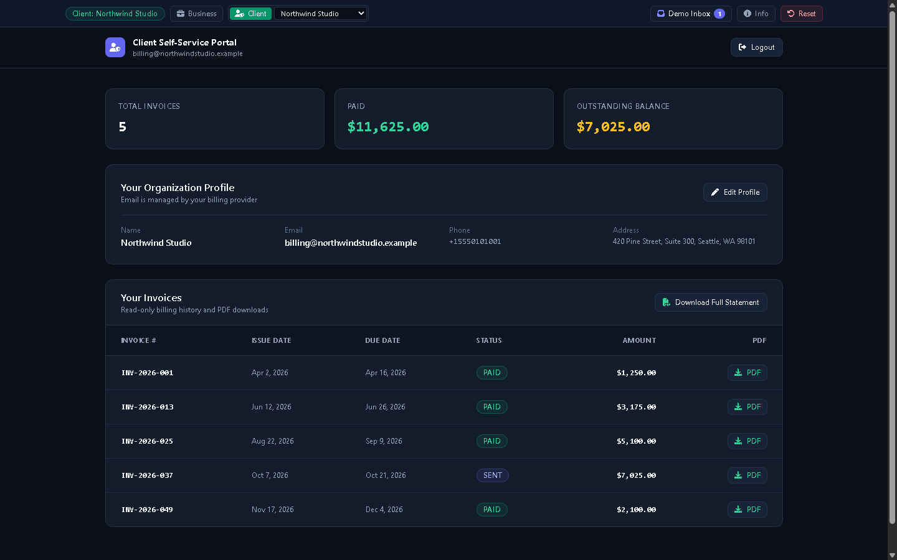

### Demo Inbox (Simulated Email Delivery)
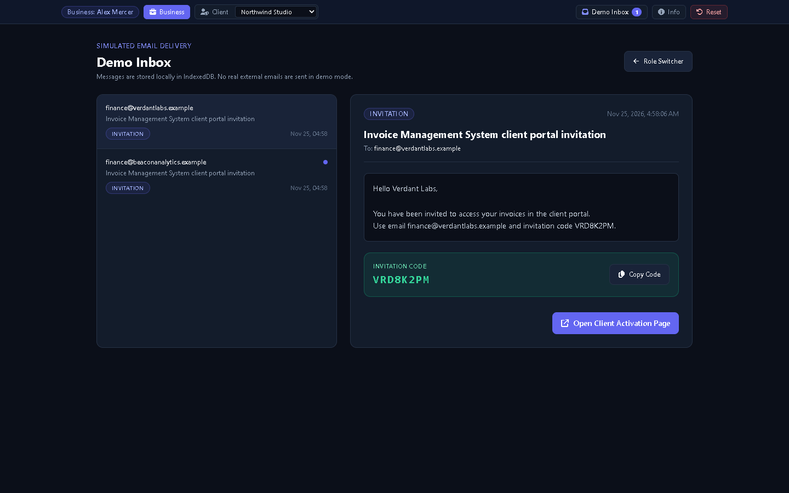

---

## Licensing & Attribution

- **Original Author:** Aymen Alioua — [MIT License](LICENSE).
- **Third-Party Libraries:** Backend PDF generation uses **OpenPDF 1.3.39** (LGPLv3 / MPLv2, compatible with MIT distribution); browser demo PDF generation uses **jsPDF** (MIT License).
